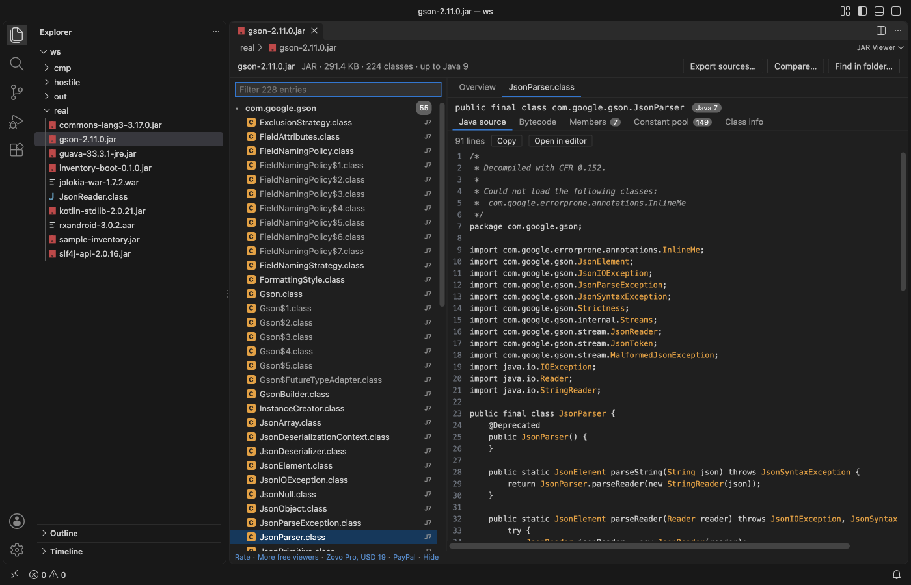
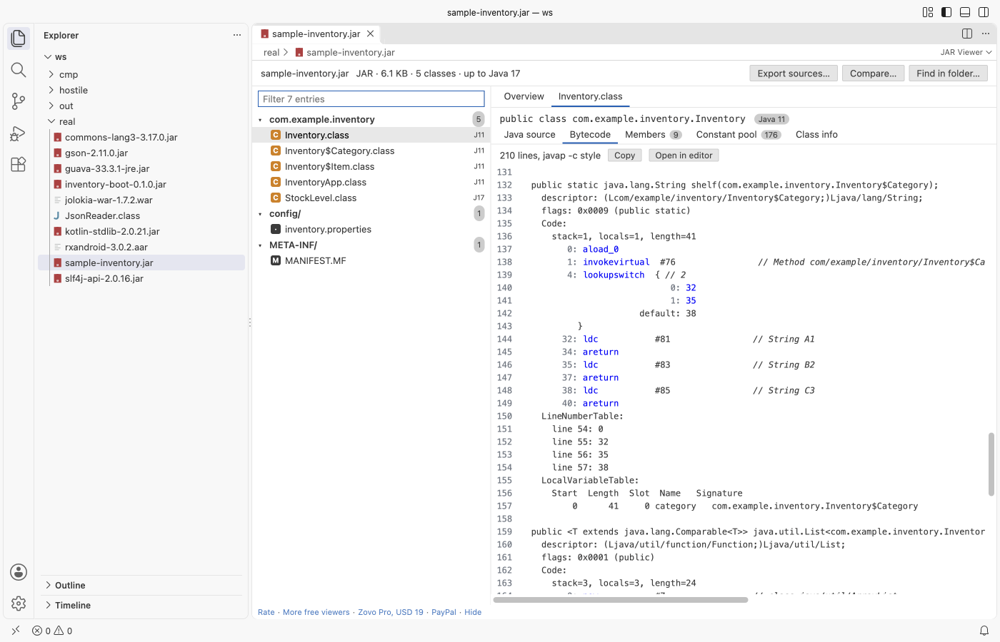
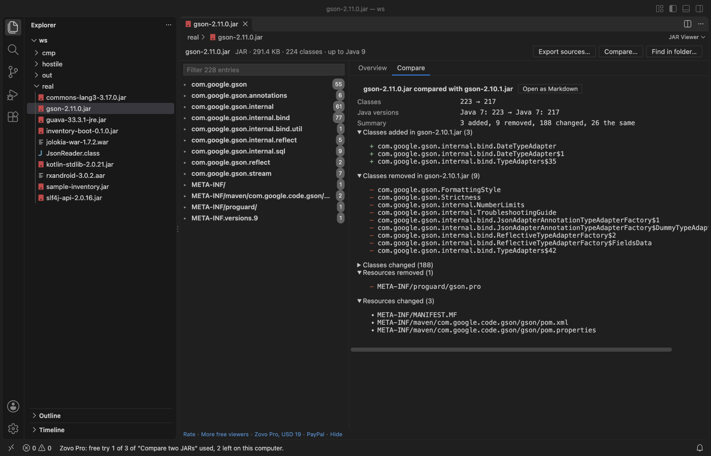

# JAR Viewer & Java Decompiler for VS Code (Class File Viewer, Bytecode)

Open a `.jar`, `.war`, `.ear`, `.aar` or `.class` file in VS Code and see what is inside: packages, classes, resources and `MANIFEST.MF`, the Java version of every class, a javap-style bytecode listing and decompiled Java source. Decompiling uses the bundled CFR decompiler and the Java runtime already on your computer. Read-only, no network.

## What you see

- Packages and resources: the archive as a tree of packages, with a filter that finds a class or file among 50,000 entries as you type. Inner classes are dimmed under their outer class.
- Overview: format, size, entry count, classes, packages, `Main-Class`, `Start-Class`, `Created-By`, module name, multi-release, and a chart of the Java versions the classes were compiled for (class file 52 is Java 8, 61 is Java 17, 65 is Java 21).
- Java source: decompiled with [CFR](https://github.com/leibnitz27/cfr) 0.152, with its inner classes. Copy it or open it in an editor tab.
- Bytecode: a `javap -c -p` style listing written in JavaScript, with every opcode, `tableswitch` and `lookupswitch`, `wide`, resolved constants, exception tables, line numbers and local variables. It needs no Java.
- Members: fields and methods as Java declarations (generic signatures included), with their descriptors, access flags and code size.
- Constant pool: every entry with its tag, references and value, with a filter.
- Class info: access flags, super class, interfaces, source file, inner classes, nest host, records, permitted subclasses, annotations and every attribute.
- Resources: text files (properties, XML, JSON, SQL, services files) open as text; binary files show a hex preview.
- Nested JARs: Spring Boot `BOOT-INF/lib`, WAR `WEB-INF/lib` and AAR `classes.jar` open one level deep, with a button back to the outer archive.

## Open a file

- Click a `.jar`, `.war`, `.ear`, `.aar` or `.class` file in the Explorer. It opens in the viewer.
- Command Palette: JAR Viewer: Open in JAR Viewer.
- A `.class` file opens on its own; its inner classes (`Name$Inner.class` in the same folder) are decompiled with it.

## Decompiling needs Java

CFR is a Java program, so decompiled source needs a Java runtime, version 8 or newer. The viewer looks for one in this order:

1. the setting `jarViewer.javaPath` (a `java` binary or a JDK/JRE folder),
2. `JAVA_HOME`,
3. `java` on your `PATH`.

Without Java, every other view works and the Java source tab shows one line on how to turn decompiling on. Nothing pops up. The command JAR Viewer: Check the Java runtime used for decompiling shows which Java is used.

CFR runs in its own process with a 45-second limit and a 512 MB memory cap. CFR gets the classes of the open JAR as one temporary file in the extension's storage folder, so the other classes of the JAR resolve; the file is deleted when you close the editor. Only one CFR process runs per editor at a time.

## Free and Pro

Everything above is free, with no limit and no sign-in. Three Zovo Pro tools save time on bigger jobs. Each has 3 free tries on your computer, and a try counts only when the tool gives you a result.

| Tool | Free | Zovo Pro |
|---|---|---|
| Packages, classes, resources, manifest, Java versions, bytecode, decompiled source, nested JARs | yes | yes |
| Export the decompiled sources of a whole JAR into a folder of `.java` files, with progress and Cancel | 3 tries | yes |
| Compare two JARs: classes added, removed and changed, method and field signatures, Java version changes, as a Markdown report | 3 tries | yes |
| Find a class, method, field or string constant in every JAR of a folder, nested JARs included (plain text or /regex/) | 3 tries | yes |

Zovo Pro is USD 19 once and turns on the Pro tools in every Zovo extension. Nothing about Pro shows when you open a file; it only comes up when you click one of the three tools. To hide the buttons, set `jarViewer.showProTools` to `false`.

## Safe with any file

- The archive is read in a separate worker thread with a time and memory limit. A broken or hostile file gives a message; it cannot freeze VS Code.
- Zip bombs are refused: an entry that claims more than 1,000 times its packed size, or unpacks to more than its header says, is stopped.
- Entry names with `..`, absolute paths or control characters are listed and marked, and never written to disk. Exports write only names that stay inside the folder you picked.
- Every count and length in a class file is checked against the bytes that are left: a constant pool of 65,535 junk entries or a cut class gives a message.
- Read-only: the extension never changes the archive.
- No network and no telemetry.

## Commands

| Command | What it does |
|---|---|
| JAR Viewer: Open in JAR Viewer | Open a JAR, WAR, EAR, AAR or class file |
| JAR Viewer: Open a sample JAR | A small sample to try the viewer |
| JAR Viewer: Check the Java runtime used for decompiling | Shows the Java that CFR runs on |
| JAR Viewer: Export decompiled sources of a JAR (Pro) | A folder of `.java` files |
| JAR Viewer: Compare two JARs (Pro) | What changed between two versions |
| JAR Viewer: Find a class, method or string in every JAR of a folder (Pro) | Search many JARs at once |

## Settings

| Setting | Default | |
|---|---|---|
| `jarViewer.javaPath` | empty | Java runtime for CFR: a `java` binary or a JDK folder |
| `jarViewer.showProTools` | `true` | Show the Export sources, Compare and Find in folder buttons |
| `jarViewer.showSupportLinks` | `true` | Show the small links at the bottom of the viewer |
| `jarViewer.askForRating` | `true` | Ask once, after a few days, whether you want to rate it |

## Limits

- Decompiled source needs Java 8 or newer on your computer. CFR output can differ from the original source (names of local variables, some generics and lambdas).
- Entries are unpacked up to 64 MB each, class files up to 16 MB, nested archives up to 128 MB. Archives can have up to 200,000 entries.
- The overview reads the Java version of up to 50,000 classes.
- Nested archives open one level deep.
- Files on remote or virtual file systems are read up to 256 MB.
- APK and DEX files are not read here.

Works in VS Code 1.90 and later, Cursor, Windsurf and VSCodium.

CFR is made by Lee Benfield and ships under the MIT license; see `THIRD-PARTY-NOTICES.md`.

## Support Zovo

Zovo Pro: USD 19 once, every Zovo viewer. [Get Zovo Pro on GitHub Sponsors](https://github.com/sponsors/theluckystrike/sponsorships?tier_id=679878) to turn on the Pro tools in this extension and in the other Zovo extensions you use. The free features stay free.

Zovo extensions have no ads and no tracking. They are made by [theluckystrike](https://github.com/theluckystrike) on GitHub. You can also support the work with no Pro:

- [Sponsor on GitHub](https://github.com/sponsors/theluckystrike)
- [PayPal](https://www.paypal.com/paypalme/najzzz)
- [Follow theluckystrike on GitHub](https://github.com/theluckystrike)

### Need your format supported?

Open a [format request](https://github.com/theluckystrike/jar-viewer-vscode/issues/new?template=format-request.yml) with a sample file, and I reply there whether it can be done. For USD 299 once, through [this GitHub Sponsors tier](https://github.com/sponsors/theluckystrike/sponsorships?tier_id=679995), I add your file format or a missing feature to this extension, with tests, within 7 days.

## More tools by Zovo

- [Hex Viewer & Binary Viewer, Hex Editor (Large Files)](https://marketplace.visualstudio.com/items?itemName=zovo.zovo-hex-viewer) opens binary files of any size, with find, a data inspector and byte editing.
- [SVN Client & Subversion Source Control (Commit, Blame, Log, Diff)](https://marketplace.visualstudio.com/items?itemName=zovo.zovo-svn-client) brings SVN commit, diff, log and blame to the Source Control view.
- [ZIP Viewer & Archive Explorer (JAR, TAR, GZ)](https://marketplace.visualstudio.com/items?itemName=zovo.zip-archive-explorer) browses ZIP, JAR, VSIX, TAR and GZ files, opens entries in tabs and extracts them safely.
- [VCD Viewer & Waveform Viewer (Verilog, No Signal Limit)](https://marketplace.visualstudio.com/items?itemName=zovo.zovo-vcd-waveform-viewer) opens Verilog, SystemVerilog and VHDL VCD waveforms with no signal limit.
- [Linker Map Viewer & Map File Analyzer (GNU ld, Memory Usage)](https://marketplace.visualstudio.com/items?itemName=zovo.zovo-linker-map-viewer) shows FLASH and RAM use from GNU ld, lld, IAR and Keil map files.

See [all Zovo extensions on the Marketplace](https://marketplace.visualstudio.com/publishers/zovo).
